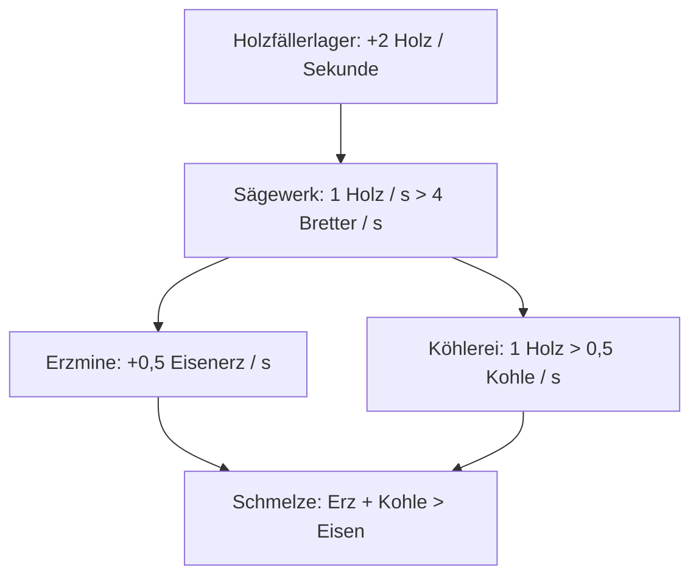

# Idle Realms: Spielkonzept v0.1

> Ursprünglicher Konzeptentwurf; keine Implementierungszusage. Redaktionelle Übertragung, Original-PDF maßgeblich.

Entwurf vom 11. Oktober 2026. Grundlage ist das [Original-PDF](references/Minecraft_Idle_Realms_Game_Design_v0.1.pdf) mit zwölf Seiten. Die [spätere Prüfung des Idle-Kerns](idle-core-review.md) behandelt offene Fragen und Empfehlungen für die Weiterentwicklung.

## Titel und Spielidee

Quelle: Original-PDF, S. 1.

**Minecraft als vollständiges Idle Game.**

Eine Welt, in der Ressourcen automatisch wachsen, Produktionsketten Entscheidungen verlangen und eine kleine Siedlung zur interdimensionalen Wirtschaft wird.

Das Konzept beschreibt eine Total Conversion. Die beispielhafte Produktionsanzeige auf dem Titel zeigt `+12 Holz / s` und `+3 Stein / s` unter den Beschriftungen "Produktion" und "Welt im Wandel".

## 01 Vision

Quelle: Original-PDF, S. 2.

Der Spieler baut eine automatisierte Wirtschaft auf. Seine Minecraft-Welt wächst mit jedem freigeschalteten Produktionssystem.

Aus einer einzelnen Holzquelle entsteht ein Netz aus Minen, Werkstätten, Forschungseinrichtungen und schließlich Produktionsstätten in drei Dimensionen. Der Fortschritt läuft passiv; die wichtigsten Entscheidungen betreffen Investitionen, Engpässe und Expansion.

### Vier Grundregeln

| Grundregel | Festlegung im Konzept |
| --- | --- |
| Passiver Fortschritt | Produktion und Erkundung laufen auch ohne Eingaben. Offline-Zeit wird beim nächsten Laden nachberechnet. |
| Die Welt bleibt sichtbar | Regionen, Gebäude und ihre Ausbaustufen verändern das Gelände. Der Weltenatlas zeigt die Wirtschaft dahinter. |
| Entscheidungen statt Klickarbeit | Der Spieler priorisiert Rohstoffe, baut Kapazität auf und löst Produktionsengpässe. |
| Neue Regeln im Lauf der Zeit | Redstone, Nether und End erweitern das Spiel um Automatisierung, Energie und Prestige. |

### Festlegungen für die erste Version

- Total Conversion.
- Virtuelle Ressourcen.
- Gebäude als Weltobjekte.
- Singleplayer zuerst.

Manuelles Abbauen, Kämpfen und Crafting sind keine Pflichtaufgaben. Wer aktiv erkundet oder baut, erreicht bestimmte Ziele früher. Die Automatik bietet immer einen vollständigen Fortschrittspfad.

## 02 Gameplay

Quelle: Original-PDF, S. 3.

Jeder Login gibt einen Überblick über neue Ressourcen, offene Engpässe und das nächste erreichbare Ziel.

### Kernschleife

| Schritt | Handlung | Ergebnis |
| --- | --- | --- |
| 01 | Produzieren | Ressourcen fließen. |
| 02 | Investieren | Gebäude wachsen. |
| 03 | Optimieren | Engpässe lösen. |
| 04 | Freischalten | Neue Regeln gelten. |

### Drei Zeithorizonte

| Zeithorizont | Zeitraum | Vorgesehener Fortschritt |
| --- | --- | --- |
| Sekunden | 15 bis 60 Sekunden | Upgrade kaufen, kleinen Erfolg erreichen, Produktionszahl verändern. |
| Minuten | 2 bis 15 Minuten | Gebäude öffnen, Produktionszweig aufbauen, Engpässe beheben. |
| Langfristig | 30+ Minuten | Region erschließen, Dimension betreten, Epochenwechsel planen. |

### Aktives und passives Spielen

Aktiv und passiv bleiben gleichwertige Wege. Beim passiven Spielen treiben Produktion, automatische Expeditionen und gekaufte Regeln den Fortschritt voran. Aktive Erkundung entdeckt Regionen früher. Ein Blick in den Weltenatlas beschleunigt Entscheidungen.

Warten ist Teil des Genres. Sichtbare Ziele, mehrere sinnvolle Investitionen und eine veränderte Spielwelt machen es interessant. Pflicht-Klicken ist nicht vorgesehen.

## 03 Ökonomie

Quelle: Original-PDF, S. 4.

Gebäude erzeugen, verbrauchen oder verarbeiten Ressourcen. Jede Produktionskette schafft neue Engpässe und Investitionsentscheidungen.

### Erste Produktionskette: Originaldarstellung

Die Verbindungen und Beschriftungen entsprechen dem Diagramm auf Seite 4.

Mehr Erzmine bringt keinen zusätzlichen Eisen-Ertrag, wenn die Schmelze am Limit arbeitet. Fehlt Kohle, stoppt die Schmelze trotz vollem Erz-Lager.

Rohstoffe liegen als Zahlen im Wirtschaftssystem vor. Blöcke und Maschinen im Gelände visualisieren ihren Zustand; sie spawnen keine Millionen Item-Entities.

## 04 Startwirtschaft

Quelle: Original-PDF, S. 5.

### Gebäude und Testwerte

Die Kosten definieren einen ersten spielbaren Kreislauf bis zur automatischen Eisenproduktion. Sie sind Balancing-Platzhalter.

| Gebäude | Baukosten | Leistung |
| --- | --- | --- |
| Weltenkern | Kostenlos | +1 Holz / s |
| Holzfällerlager | 25 Holz | +2 Holz / s |
| Steinbruch | 50 Holz | +1 Stein / s |
| Sägewerk | 80 Holz, 30 Stein | 1 Holz / s → 4 Bretter / s |
| Lagerhaus | 40 Holz, 40 Stein | +5.000 Lagerkapazität |
| Köhlerei | 100 Bretter, 80 Stein | 1 Holz / s → 0,5 Kohle / s |
| Erzmine | 120 Bretter, 100 Stein | +0,5 Eisenerz / s |
| Schmelze | 100 Bretter, 120 Stein | 0,5 Erz + 0,5 Kohle → 0,5 Eisen / s |

### Drei Upgrade-Typen

| Typ | Wirkung |
| --- | --- |
| Kapazität | Mehr parallele Aufträge oder größere Lager. |
| Effizienz | Gleiche Leistung bei geringerem Verbrauch. |
| Durchsatz | Höhere Produktion pro realer Sekunde. |

Kosten, Startlager und Baureihenfolge werden in Tests abgestimmt. Der erste Prototyp muss ohne festgefahrene Produktionskette zur Eisenschmelze führen.

## 05 Raumgefühl

Quelle: Original-PDF, S. 6.

Regionen geben den Gebäuden einen Standort. Ihre Eigenschaften beeinflussen Produktion, Expansion und das Erscheinungsbild der Siedlung.

### Biome

| Biom | Bonus oder Eigenschaft | Beschreibung |
| --- | --- | --- |
| Wald | +30 % Holz | Gut für Holzfäller, Sägewerke und Forstwirtschaft. |
| Gebirge | +30 % Erze | Erhöht den Ertrag von Erzminen und Steinbrüchen. |
| Ebene | Mehr Bauplätze | Bietet zusätzliche Flächen und Lageroptionen. |

### Eine Region, vier Bauplätze

Die Beispielregion zeigt vier Plätze in einer Anordnung von zwei mal zwei:

| Position | Beschriftung in der Originaldarstellung |
| --- | --- |
| Oben links | Holz, LV 03 |
| Oben rechts | Sägewerk, LV 02 |
| Unten links | Mine, LV 01 |
| Unten rechts | + Bauplatz |

Nachbarschaft zählt. Eine Schmelze in der Nähe einer Erzmine erhält einen Logistikbonus. Später steuert der Spieler Bauaufträge automatisch.

Erkundung bleibt optional. Expeditionsaufträge entdecken Regionen passiv. Wer selbst loszieht, findet neue Flächen früher.

### Sichtbare Gebäudestufen

| Stufe | Erscheinungsbild | Entwicklung |
| --- | --- | --- |
| I | Holzhütte | Kleine Produktion. |
| II | Werkstatt | Vernetzte Wirtschaft. |
| III | Industriekomplex | Großproduktion. |

## 06 Fortschritt

Quelle: Original-PDF, S. 7.

Mit jeder Ära kommen Mechaniken hinzu. Neue Ressourcen dienen dabei als Zugang zu anderen Strategien.

### Fünf Ären

| Ära | Zeitfenster | Ressourcen und Systeme | Neue Spielweise |
| --- | --- | --- | --- |
| I: Die Anfänge | 0 bis 15 Minuten | Holz, Stein, Bretter; erste Produktion und einfache Verarbeitung. | Der Spieler lernt den Kreislauf. |
| II: Industrialisierung | 15 bis 45 Minuten | Eisen, Kohle, Transport und Dorfbewohner. | Produktionsketten und automatische Bauaufträge. |
| III: Technologie | 45 bis 90 Minuten | Redstone, Diamanten, Energieversorgung. | Automatisierungsregeln für größere Netze. |
| IV: Der Nether | 90 bis 150 Minuten | Netherquarz, Lavaenergie und neue Multiplikatoren. | Eine zweite Dimension wird Teil der Wirtschaft. |
| V: Das End | 150 bis 240 Minuten | Enderenergie, Fernlogistik und End-Expedition. | Epochenwechsel und permanente Freischaltungen. |

Alle Zeiten beziehen sich auf einen aktiven Erstlauf als grobe Designziele. Offline-Phasen, Spielstil und Balancing verändern die tatsächliche Dauer.

## 07 Meta-Progression

Quelle: Original-PDF, S. 8.

### Epochenwechsel

Nach dem ersten großen End-Meilenstein startet eine neue Epoche. Die gestaltete Welt bleibt als sichtbare Spur der bisherigen Entwicklung bestehen.

| Wird zurückgesetzt | Bleibt erhalten |
| --- | --- |
| Ressourcenvorräte | Gebäudestrukturen und Standorte |
| Gebäude-Level | Freigeschaltete Erfolge |
| Laufende Produktionsaufträge | Epochenpunkte |
| Temporäre Forschung | Permanente Freischaltungen |

### Verwendung der Epochenpunkte

| Spezialisierung | Freischaltungen und Boni | Wirkung auf den nächsten Durchlauf |
| --- | --- | --- |
| Industrie | Bessere Grundproduktion und frühere Maschinen. | Industrialisierung läuft schneller. |
| Erkundung | Expeditionen erschließen Regionen in kürzerer Zeit. | Mehr Standorte stehen früher bereit. |
| Magie | Neue Energiequellen und dimensionsweite Boni. | Andere Produktionsstrategien werden sinnvoll. |

Neue Durchläufe erhalten Abkürzungen und exklusive Freischaltungen. Die Wiederholung des exakt gleichen Ablaufs mit bloß höheren Multiplikatoren reicht nicht als Prestige-System.

Für den ersten Epochenwechsel gilt ein Richtwert von zwei bis vier Stunden aktiver Optimierung. Permanente Boni verkürzen spätere Durchläufe.

## 08 Benutzerführung

Quelle: Original-PDF, S. 9.

### Weltenatlas

Ein zentrales Menü bündelt Ressourcenvorräte, Produktionsraten, Bauaufträge und Ziele. Direktes Bauen in der Welt bleibt eine ergänzende Ansicht.

Die Beispieloberfläche zeigt den Weltenatlas für "Siedlung / Ära II".

| Ressource | Vorrat | Angezeigte Rate |
| --- | ---: | ---: |
| Holz | 2.400 | +12 / s |
| Stein | 780 | +3 / s |
| Eisen | 125 | +0,5 / s |

Das nächste Ziel lautet "Automatische Schmelze bauen". Die Anzeige meldet "75 % abgeschlossen" und "2 Min. bis zur Kohlemenge".

| Betrieb | Anzeige |
| --- | --- |
| Holzfällerlager | +12 Holz / s |
| Erzmine | +0,5 Erz / s |
| Schmelze | Wartet auf Kohle |

Die Navigation enthält die Bereiche Produktion, Forschung, Regionen und Statistik.

### Regeln für das Interface

- Jede Ausgabe zeigt vor dem Kauf die erwartete Veränderung der Produktion.
- Engpässe stehen direkt beim betroffenen Produktionszweig.
- Ziele und abgeschlossene Offline-Produktion bleiben nach dem Login klar erkennbar.

## 09 Implementierung

Quelle: Original-PDF, S. 10.

Die Simulation funktioniert unabhängig davon, welche Chunks gerade geladen sind. Die Blockwelt zeigt den Zustand der Wirtschaft.

### Systemgrenzen

| System | Zuständigkeit |
| --- | --- |
| Wirtschaft | Ressourcen, Produktionsraten, Lager, Abhängigkeiten. |
| Weltzustand | Regionen, Bauplätze, Gebäude-Level, Forschung. |
| Darstellung | Blockstrukturen, Animationen, Atlas, Statusanzeigen. |

### Berechnung und Persistenz

| Bereich | Festlegung |
| --- | --- |
| Simulation | Ein zentraler Simulator verwaltet Ressourcenflüsse und Produktionslimits. |
| Offline-Zeit | Gespeicherten Zeitstempel lesen; Produktionsschritte unter Beachtung von Lagergrenzen und Inputs nachrechnen. |
| Chunks | Fabriken produzieren auch ohne geladene Weltabschnitte. Sichtbare Animationen sind rein lokal. |
| Speicherung | Weltweite Ökonomiedaten und Regionseinträge werden persistent gespeichert. |
| Netzwerk | Singleplayer zuerst. Später serverautoritatives Modell für Multiplayer. |

Offline-Fortschritt wird als Simulation von Ressourcenwerten berechnet. Es werden keine Blöcke rückwirkend abgebaut und keine Item-Entities für vergangene Produktion erzeugt.

## 10 Produktion: Prototyp v0.1

Quelle: Original-PDF, S. 11.

Die erste Version endet mit einer funktionsfähigen, vollständig automatisierten Eisenschmelze. Alles andere bleibt zunächst aus dem Scope.

### Enthaltene Systeme

- Weltenkern mit passiver Holzproduktion.
- Virtuelle Rohstoffe und Lagergrenzen.
- Holzfällerlager und Steinbruch.
- Sägewerk, Köhlerei, Erzmine und Schmelze.
- Upgrade-Käufe und Kostenanzeige.
- Produktionsoberfläche und Engpasshinweise.
- Persistenter Fortschritt und Offline-Zeit.
- Sichtbare Gebäude in einer Region.

### Nicht Teil der Version 0.1

- Nether und End.
- Prestige.
- Multiplayer.
- Komplexe Logistik.

### Erster Testdurchlauf: 15 Minuten

| Zeitraum | Vorgesehener Ablauf |
| --- | --- |
| 0 bis 2 Minuten | Holzquelle verstehen und erstes Holzfällerlager bauen. |
| 2 bis 5 Minuten | Steinbruch errichten, Rohstoffe gezielt ansparen. |
| 5 bis 10 Minuten | Sägewerk bauen und Bretter für die nächsten Schritte produzieren. |
| 10 bis 15 Minuten | Köhlerei, Erzmine und Schmelze vorbereiten; Eisenfluss starten. |

### Erfolgskriterien

- Ein kompletter Durchlauf gelingt ohne manuelles Farmen.
- Der Spieler versteht, warum die Schmelze produziert oder stillsteht.
- Ressourcenzahlen und Bauzustand bleiben nach einem Neustart korrekt.

## 11 Offene Punkte

Quelle: Original-PDF, S. 12.

Einige Festlegungen entscheiden früh über Aufwand, Spielgefühl und spätere Erweiterbarkeit.

### Risiken im Design

| Risiko | Vorgesehene Behandlung |
| --- | --- |
| Warten ohne Entscheidung | Neue Upgrades müssen eine messbare Wahl eröffnen. Zu lange Leerlaufphasen werden gekürzt. |
| Unverständliche Produktion | Engpässe und Energie- beziehungsweise Lagerlimits sind auf einen Blick erkennbar. |
| Pflicht zum Bauen | Spätere Automatik übernimmt auch Gebäudekäufe und Bauaufträge. |
| Prestige ohne Variation | Permanente Spezialisierungen verändern Aufbauwege und Freischaltungen. |

### Bewusst offen

- Wie viele virtuelle Ressourcen gleichzeitig sichtbar sind.
- Welche Aktionen beim Erkunden einen direkten Bonus geben.
- Wie sich Bauplätze und Dimensionen in bestehenden Welten verhalten.
- Welche Minecraft- und Mod-Loader-Version den technischen Startpunkt bildet.

### Nächste Entwicklungsschritte

| Reihenfolge | Arbeitsschritt | Inhalt |
| --- | --- | --- |
| 01 | Wirtschaftskern | Ressourcen, Kosten, Inputs, Outputs. |
| 02 | Bedienung | Atlas, Gebäude-Upgrades, Engpassanzeige. |
| 03 | Welt und Offline | Bauplätze, Persistenz, Nachberechnung. |

Status des Originals: Spielkonzept v0.1. Alle Zahlen und Zeitziele sind Startannahmen für Playtests. Der spielbare Vertical Slice liefert die Grundlage für das eigentliche Balancing.
