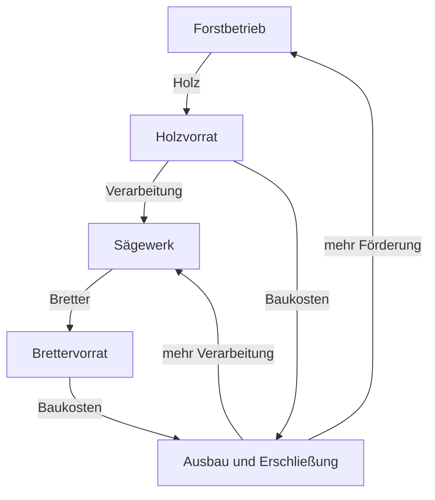

# Konzeptprüfung und sichtbarer Idle-Kern

Stand: 11. Oktober 2026.

Status: dokumentierte Prüfung und Empfehlungen aus der Konzeptdiskussion. Die Vorschläge sind noch keine bestätigte Implementierungsspezifikation. Der [Entscheidungsstand](decisions.md) unterscheidet sie von den ausdrücklich genannten Zielen und dem [ursprünglichen Konzept v0.1](game-design-v0.1.md).

## Ausgangspunkt

Der Projektinhaber beschreibt ein Minecraft-Idle-Game, in dem der Spieler den automatischen Fortschritt beobachtet, durch die Welt läuft und dort Entscheidungen über Upgrades trifft. Die langfristige Idee ist groß angelegt; zuerst soll die Grundlage des Idle-Spiels funktionieren. Als mögliche Ansätze wurden alternative Golems mit sichtbaren Tätigkeiten und zunächst vier verfügbare Chunks mit späteren Freischaltungen genannt.

Die Empfehlung der Prüfung ist eine begehbare Siedlung mit automatisch arbeitenden Betrieben und fest zugeordneten Golems. Die Tätigkeit der Arbeiter erklärt die laufende Produktion. Ausbauten verändern bekannte Orte. Erschlossene Flächen eröffnen zusätzliche Produktionsmöglichkeiten. Ressourcen fließen wieder in eine leistungsfähigere Wirtschaft.

## 1. Befunde zum ursprünglichen Konzept

Virtuelle Ressourcen, eine von geladenen Chunks unabhängige Simulation und ein vollständiger Fortschrittspfad ohne manuelles Farmen passen zum gewünschten Spiel. Sichtbare Gebäudestufen bieten eine Grundlage für erkennbares Wachstum. Die Begrenzung der ersten Version sowie der Ausschluss von Nether, End, Prestige und Multiplayer schützen den ersten Test vor einem zu großen Umfang. Diese Festlegungen stehen im Original auf den Seiten 2, 4, 6, 10 und 11.

### Weltbedienung und Atlas

Auf Seite 9 bündelt der Atlas die Bedienung; direktes Bauen bleibt eine ergänzende Ansicht. Die präzisierte Absicht des Projektinhabers verlangt mehr Informationswert in der Welt. Betriebe benötigen erkennbare Arbeitszustände und direkte Interaktion. Genaue Zahlen, Vergleiche und spätere Fernverwaltung passen in den Atlas. Beide Bedienwege bleiben verfügbar.

### Bauplätze und Produktionskette

Seite 6 nennt vier Bauplätze pro Region. Der Prototyp auf Seite 11 enthält sechs Produktionsgebäude: Holzfällerlager, Steinbruch, Sägewerk, Köhlerei, Erzmine und Schmelze. Die Tabelle auf Seite 5 ergänzt Weltenkern und Lagerhaus. Selbst ohne eigenen Platzbedarf für Kern und Lager reichen vier Plätze nicht.

Vor der Umsetzung braucht es eine passende Regel: mehr Plätze, mehrere Module pro Bauplatz oder eine frühe Erweiterung. Vier Chunks sind eine Flächenangabe und legen die Anzahl der Gebäude nicht fest.

### Herkunft der Startressourcen

Der kostenlose Weltenkern erzeugt auf Seite 5 Holz. Das sichert den rechnerischen Start, erklärt aber noch keine sichtbare Arbeit. Empfohlen wird ein bereits arbeitender Forstbetrieb oder eine sichtbar regenerierende Holzquelle, die der Kern bereitstellt.

### Baukosten und laufender Verbrauch

Das Schaubild auf Seite 4 führt vom Sägewerk zur Erzmine und Köhlerei. Die Pfeile lassen Bretter wie laufende Produktionsinputs erscheinen. Laut Tabelle auf Seite 5 gehören Bretter dort zu den Baukosten; die Köhlerei verbraucht Holz, die Erzmine erzeugt Erz ohne aufgeführten laufenden Materialinput.

Die spätere Oberfläche trennt Bauvoraussetzungen und laufende Ressourcenflüsse. Beim Sägewerk ist beispielsweise Holzverbrauch pro Sekunde eine Betriebsregel; seine einmaligen Stein- und Holzkosten gehören zum Bauauftrag.

### Investitionsalternativen und Zeitziele

Die ursprüngliche Kette enthält weitgehend notwendige Käufe. Ihre Reihenfolge verändert zunächst vor allem Zwischenbestände. Die Upgrade-Typen Kapazität, Effizienz und Durchsatz benötigen konkrete Kosten und Wirkungen, die unterschiedliche Ziele unterstützen.

Eine Nachrechnung mit den ursprünglichen Zahlen ergibt folgenden möglichen Ablauf:

| Kauf | Zeit seit Start |
|---|---:|
| Holzfällerlager | 25,0 Sekunden |
| Steinbruch | 41,7 Sekunden |
| Sägewerk | 71,7 Sekunden |
| Köhlerei | 151,7 Sekunden |
| Erzmine | 251,7 Sekunden |
| Schmelze | 371,7 Sekunden |

Annahmen der Rechnung: Startvorräte null; Weltenkern erzeugt ab Start 1 Holz/s; Käufe erfolgen sofort, sobald die jeweilige Menge vorliegt; ausreichend Bauplätze; keine Bauzeiten, Lagergrenzen oder Upgrades; kein optionales Lagerhaus; kontinuierliche Produktion und die im Original angegebenen Baukosten und Raten. Nach Bau des Holzfällerlagers beträgt die Holzerzeugung zusammen mit dem Kern 3 Holz/s. Das Sägewerk verbraucht davon 1 Holz/s, die Köhlerei später ebenfalls 1 Holz/s.

Die sechs Produktionsgebäude benötigen zusammen 330 Stein. Nach dem Start des Steinbruchs verstreichen für diese Menge 330 Sekunden. Damit beginnt die Eisenproduktion nach rund 6 Minuten und 12 Sekunden. Das im Konzept angestrebte Fenster von 10 bis 15 Minuten folgt noch nicht aus den Zahlen allein. Die Werte sind im Original ausdrücklich als Platzhalter gekennzeichnet; diese Rechnung ist kein Spieltest.

### Prestige und erhaltene Gebäude

Die Gebäudeform wächst laut Seite 6 mit dem Level. Beim Epochenwechsel bleiben laut Seite 8 Gebäudestrukturen erhalten, während die Level zurückgesetzt werden. Die spätere Gestaltung benötigt eine Erklärung für große Anlagen mit wieder kleiner Anfangsleistung, etwa stillgelegte Anbauten. Der erste Prestige-Zeitpunkt von zwei bis vier Stunden ist ebenfalls ein ungetestetes Ziel. Prestige bleibt außerhalb des ersten Prototyps.

### Folgerung für die Entwicklungsreihenfolge

Sichtbare Arbeit gehört in den ersten Test des Wirtschaftskerns. Ein Ressourcenmenü prüft die Berechnung, aber noch nicht das gewünschte Beobachten und Herumlaufen. Die vollständige Eisenkette folgt nach einem kleineren sichtbaren Kreislauf.

## 2. Beispiel für den Spieleinstieg

Eine kleine Lichtung enthält bereits eine einfache Arbeitsstelle. Ein Golem geht zu einem Baum, fällt ihn, bringt ein Bündel zum Holzplatz und setzt einen neuen Setzling. Der sichtbare Holzstapel wächst.

Der erste Ausbau verändert diesen Arbeitsplatz. Ein zusätzliches Gerät, eine weitere Arbeitsstelle oder ein zweiter Golem erklärt die höhere Leistung. Das später errichtete Sägewerk verbraucht Holz und lässt Bretter am Auslauf entstehen. Eine Verbesserung der Verarbeitung erhöht die Brettmenge; der Holzstapel wächst dadurch langsamer.

Am Rand liegt ein unerschlossenes Grundstück. Eine Bautafel nennt den Materialbedarf und die spätere Nutzung. Der Spieler entscheidet zwischen dem Ausbau vorhandener Betriebe und dem Ansparen für dieses Grundstück.

Wiederholte Arbeitszyklen, sichtbare Betriebszustände und größere bauliche Veränderungen haben unterschiedliche Geschwindigkeiten. Ein einzelner Arbeitsgang liefert häufig ein kleines Ergebnis. Ein Anbau bleibt als Folge einer größeren Investition stehen. Eine Erschließung verändert die Siedlung nach einem längeren Sparziel. Größere Fortschrittsschritte benötigen mehr als eine beschleunigte Animation.

## 3. Golems als sichtbare Arbeiter

Der Kupfergolem ist seit Java Edition 1.21.9 vom 30. September 2025 Teil von Vanilla Minecraft. Seine dokumentierte Funktion ist das Aufnehmen von Gegenständen aus Kupfertruhen und das Sortieren in geeignete andere Truhen. Allgemeines Holzfällen, Bergbau und der Betrieb eines Sägewerks sind zusätzliche Arbeitsrollen für diese Mod. Quelle: [Mojang, Java Edition 1.21.9](https://www.minecraft.net/en-us/article/minecraft-java-edition-1-21-9), Abschnitte „Copper Golem“ und „Copper Golem Item Sorting“.

### Zuordnung zum Betrieb

Für den ersten Prototyp wird empfohlen, den Arbeiter in den Gebäudekauf einzuschließen. Ein Forstbetrieb erhält einen Golem mit Axt und einen begrenzten Arbeitsbereich. Das Sägewerk besitzt einen eigenen Arbeiter. Die Ausbaustufe bestimmt Arbeitsplätze, Geräte und die dargestellte Unterstützung.

Ein globaler Golem-Pool bleibt eine spätere Option. Er benötigt Regeln für Rekrutierung, Arbeitsplatzwechsel, untätige Arbeiter und den Nutzen wiederholter Umverteilung. Diese zusätzliche Entscheidungsebene gehört noch nicht zum ersten Nachweis.

Ein Grundmodell mit unterschiedlichen Werkzeugen und Arbeitsanimationen genügt zunächst. Weitere Materialien oder Golem-Arten erhalten später eine Aufgabe, wenn sie unterschiedliche Fähigkeiten tragen.

### Zusammenhang mit der Wirtschaft

Die sichtbare Tätigkeit entspricht dem Zustand des Betriebs. Bei fehlendem Holz wartet der Arbeiter am leeren Einlauf. Bei vollem Bretterlager ruht die Säge. Nach einem Ausbau nutzt der Arbeiter den neuen Arbeitsplatz.

Für den Anfang genügen kurze, verlässliche Abläufe innerhalb festgelegter Betriebsflächen. Freie Wegsuche durch beliebig verändertes Gelände, individuelle Inventare und wirtschaftlich notwendige Transportwege sind zusätzliche Systeme. Der gespeicherte Betriebszustand bestimmt die Produktion; die tatsächlich gelaufene Strecke des sichtbaren Golems bestimmt sie im ersten Prototyp nicht.

### Wartung und Skalierung

Regelmäßige Pflegepflichten passen nicht zum empfohlenen ersten Idle-Kern. Der Vanilla-Kupfergolem wird bei vollständiger Oxidation ohne Wachs zur Statue. Bei Übernahme dieser Eigenschaft braucht es eine dauerhafte automatische Lösung. Für den ersten Test wird empfohlen, eine solche Wartungsmechanik wegzulassen. Quelle: [Mojang, Java Edition 1.21.9](https://www.minecraft.net/en-us/article/minecraft-java-edition-1-21-9), Abschnitt „Copper Golem“.

Frühe Upgrades können zusätzliche Golems zeigen. Später tragen größere Arbeitsstellen, Ladungen und Maschinen den sichtbaren Fortschritt. Die dargestellte Arbeiterzahl wächst nicht unbegrenzt mit jeder Produktionsverdopplung.

## 4. Die Welt als Informationsquelle

| Wirtschaftlicher Zustand | Darstellung am Betrieb | Direkte Interaktion |
|---|---|---|
| Produktion läuft | Golem arbeitet, Maschine bewegt sich, Material erscheint am vorgesehenen Ort. | Aktueller Ertrag und Verbrauch. |
| Ein Rohstoff fehlt | Leerer Einlauf, ruhende Maschine, wartender Arbeiter. | Benötigter Rohstoff und passende Eingriffe. |
| Ausgabelager voll | Volle Lagerfläche, gestapelte Ware am Ausgang. | Kapazität und Ausbauoption. |
| Bewusst pausiert | Erkennbar stillgelegter Arbeitsplatz. | Pausenzustand und Fortsetzen. |
| Ausbau läuft | Gerüst, Baumaterial und sichtbare Bauabschnitte. | Baufortschritt und Wirkung nach Fertigstellung. |

Ein Holzstapel stellt einige klar unterscheidbare Füllstände dar. Die genaue Stückzahl steht in der Oberfläche. Größere Upgrades erhalten dauerhafte Veränderungen wie Anbauten, Werkzeuge, Arbeitsplätze oder Maschinen. Kleine Zahlenverbesserungen brauchen keine vollständig neue Struktur.

Direkte Gebäudeinteraktion und Atlas bleiben gleichberechtigte Bedienwege. Der Rundgang erklärt den Zustand. Die Gebäudeansicht nennt Ursachen und Eingriffe. Der Atlas ermöglicht Vergleiche und spätere Fernverwaltung.

Sichtbare Holzstapel und Gebäudeteile repräsentieren virtuelle Werte. Ihr Abbau darf dieselben Ressourcen nicht zusätzlich erzeugen. Für den ersten Prototyp werden getrennte Regeln für Produktionsvorräte und frei verwendbare Gestaltungsblöcke empfohlen.

## 5. Ein kleiner Wirtschaftskreislauf

Holz und Bretter reichen, um Erzeugung, Verarbeitung und Investitionen gemeinsam zu prüfen.

Die Pfeile zum Ausbau zeigen Investitionen. Die Pfeile durch das Sägewerk zeigen laufenden Verbrauch.

### Förderung gegen Verarbeitung

Die folgenden Werte sind ein vereinfachtes Testmodell aus der Prüfung. Sie sind keine bestätigten Balancewerte und werden nicht zur ursprünglichen Tabelle addiert. Insbesondere enthält dieses Modell keine zusätzliche Holzproduktion eines Weltenkerns.

| Zustand | Holzerzeugung | Holzverbrauch des Sägewerks | Bretterproduktion | Zuwachs des Holzvorrats |
|---|---:|---:|---:|---:|
| Ausgangszustand | 2/s | 1/s | 4/s | 1/s |
| Forstbetrieb verbessert | 3/s | 1/s | 4/s | 2/s |
| Sägewerk verbessert | 2/s | 2/s | 8/s | 0/s |

Das verbesserte Sägewerk liefert schneller Bretter, verbraucht aber die gesamte laufende Holzerzeugung. Während seines ununterbrochenen Betriebs entsteht keine zusätzliche Holzreserve. Der verbesserte Forstbetrieb vergrößert zunächst den Holzvorrat; ohne zusätzliche Verarbeitung bleibt die Brettproduktion gleich.

Das nächste Bauziel bestimmt den Nutzen einer Investition. Ein hoher Bretterbedarf begünstigt Verarbeitung. Ein hoher Holzbedarf begünstigt Förderung oder vorübergehend weniger Verarbeitung. Die Kaufvorschau zeigt deshalb auch den veränderten Verbrauch und den erwarteten Nettozuwachs betroffener Rohstoffe.

Eine kostenlose Pause des Sägewerks reicht als erste Korrekturmöglichkeit. Später kann eine gespeicherte Mindestreserve wiederholte Eingriffe vermeiden: Nur Material oberhalb dieser Reserve wird verarbeitet.

### Lagerkapazität und Abwesenheit

Auch dieses Beispiel enthält bewusst kleine Testwerte. Beide Upgrades kosten gleich viel, der Brettervorrat beginnt bei null, es erfolgen keine Bauausgaben, und Holz ist für die jeweilige Verarbeitung ausreichend verfügbar.

| Option | Bretterproduktion | Kapazität für Bretter |
|---|---:|---:|
| Produktionsupgrade | 8/s | 1.200 |
| Lagerupgrade | 4/s | 2.400 |

| Zeit ohne Eingriff | Vorrat mit Produktionsupgrade | Vorrat mit Lagerupgrade |
|---|---:|---:|
| 1 Minute | 480 | 240 |
| 5 Minuten | 1.200 | 1.200 |
| 10 Minuten | 1.200 | 2.400 |

Für den Brettervorrat unterstützt das Produktionsupgrade das nähere Ziel, das Lagerupgrade die längere Abwesenheit. Bei vollem Bretterlager stoppt die Verarbeitung. Dadurch sammelt die Produktionsvariante danach mehr unverarbeitetes Holz; der aktuelle Bauplan entscheidet auch über den Wert dieses Vorrats.

Die reale Lagergröße richtet sich nach der angestrebten Abwesenheit. Eine Stunde ununterbrochene Produktion bei 8 Brettern/s benötigt beispielsweise 28.800 freie Plätze für Bretter. Häufig volle Lager setzen einen entsprechend kurzen Rhythmus für Rückkehr und Eingriffe.

### Schutz vor wirtschaftlichen Sackgassen

Die Pflichtquelle am Start regeneriert automatisch. Dauerhaft erschöpfte Startressourcen blockieren den Fortschritt, wenn neue Quellen dieselbe Ressource kosten. Ebenso darf der letzte belegte Bauplatz keine notwendige Erweiterung unerreichbar machen.

Empfohlen werden ein kostenlos wiederherstellbarer Startbetrieb sowie verlustfreies Versetzen oder Zurückbauen im Prototyp. Frühe Fehlkäufe verändern damit das Tempo und die Richtung, bleiben aber korrigierbar.

## 6. Vier Chunks und räumliche Entwicklung

Ein Chunk besitzt horizontal 16 × 16 Blöcke. Vier benachbarte Chunks in einer Anordnung von 2 × 2 ergeben eine Grundfläche von 32 × 32 Blöcken beziehungsweise 1.024 Blockpositionen. Die horizontale Chunk-Größe ist in der [offiziellen Microsoft-Dokumentation](https://learn.microsoft.com/en-us/minecraft/creator/documents/tickingareacommand?view=minecraft-bedrock-stable) beschrieben. Die Quelle behandelt Bedrock-Ticking-Areas; hier wird daraus nur die horizontale Flächenangabe verwendet.

Die Fläche ist eine Startannahme. Ob Gebäude und Wege darin funktionieren, muss mit echten Grundrissen geprüft werden.

| Begriff | Bedeutung im vorgeschlagenen Modell |
|---|---|
| Chunk | Technische Flächeneinheit. |
| Grundstück oder Bauplatz | Für einen Betrieb nutzbare Fläche. |
| Region | Zusammenhängender Bereich mit bestimmten Eigenschaften. |

Ein Chunk kann mehrere kleine Arbeitsstellen enthalten. Ein großer Betrieb kann mehrere Chunks beanspruchen. Die technische Grenze legt damit nicht die Zahl der Gebäude fest.

### Erschließung statt verpflichtender harter Weltgrenze

Empfohlen werden zunächst vier wirtschaftlich erschlossene Chunks. Angrenzendes Gelände bleibt sichtbar und erkundbar; automatisierte Betriebe benötigen erschlossenes Gebiet. Eine harte Grenze bleibt als andere Gestaltungsmöglichkeit offen, etwa für eine abgeschlossene Insel oder einen bewusst begrenzten Realm.

Die Erschließung verändert den Ort sichtbar: Ein Weg entsteht, ein Übergang wird ausgebaut oder eine neue Betriebsfläche wird markiert. Neue Fläche eröffnet eine konkrete Möglichkeit, etwa einen weiteren Forstbetrieb, einen später benötigten Steinbruch oder einen größeren Ausbau.

Für den ersten Test genügt eine sichtbare Erweiterung. Eine spätere Auswahl zwischen Nachbarflächen ermöglicht unterschiedliche Produktionswege, beispielsweise Wald für Holz und Felskante für den nächsten Rohstoff.

Die erste Erweiterung benötigt ausschließlich bereits erreichbare Ressourcen. Wenn ein Steinbruch neues Land und dieses Land wiederum Stein erfordert, fehlt ohne weitere Quelle ein vollständiger Anfangspfad.

Eine fest gestaltete Startregion bietet zunächst bekannte Bedingungen. Eine spätere zufällige Erzeugung muss dieselben notwendigen Anfangsmöglichkeiten garantieren. Das Verhalten in bestehenden Survivalwelten bleibt offen.

## 7. Wirtschaft, sichtbare Arbeit und Offline-Zeit

Die im ursprünglichen Konzept auf Seite 10 vorgesehene Trennung bleibt die technische Empfehlung. Ein gespeicherter Betrieb besitzt Standort, Ausbaustufe, Produktionsregeln und Zustand. Daraus entstehen Erträge und die sichtbare Tätigkeit.

Die tatsächlich gelaufenen Schritte eines Golems bestimmen im ersten Prototyp keine Produktionsmenge. Umwege, entladene Gebiete und geschlossene Spielsitzungen verändern damit nicht die fachlichen Produktionsregeln. Die Darstellung muss trotzdem den aktuellen Zustand verlässlich wiedergeben: Eine wartende Schmelze produziert weder in der Rechnung noch in ihrer Arbeitsanimation.

Die Rechnung „letzte Produktionsrate mal vergangene Zeit“ ist nur während unveränderter Bedingungen korrekt. Volle Lager, leere Inputs und abgeschlossene Bauaufträge verändern diese Bedingungen. Die Nachberechnung berücksichtigt diese Übergänge und berechnet die weitere Zeit mit dem daraus folgenden Zustand.

Nach der Rückkehr zeigt die Welt die aktuellen Lagerfüllstände und die bereits beauftragten, inzwischen fertigen Ausbauten. Betriebe arbeiten oder warten entsprechend ihren Voraussetzungen. Die Rückkehrübersicht nennt Erträge und wesentliche Produktionsstopps.

Neue Investitionen bleiben zunächst Spielerentscheidungen. Ressourcen machen einen Bau bezahlbar; ein erteilter Bauauftrag gibt die Ausgabe frei. Automatische Kaufregeln sind eine spätere Erweiterung.

Prüfkriterium: Bei gleichem Ausgangszustand und ohne Eingriffe liefern zehn Minuten unbeaufsichtigte Online-Zeit und zehn Minuten Offline-Zeit dieselben wirtschaftlichen Ergebnisse. Pause, maximale berücksichtigte Abwesenheit und der Umgang mit geänderter Systemzeit benötigen noch ausdrückliche Regeln; hier sind keine Regeln dafür beschlossen.

## 8. Aktives Spielen

Der vollständige passive Fortschrittspfad aus dem Original und Vorteile durch aktives Spielen sind vereinbar. Die Bedeutung von „gleichwertig“ ist dabei vollständige Erreichbarkeit, nicht zwingend gleiche Geschwindigkeit.

Aktive Spieler erkennen Engpässe früher, treffen Entscheidungen, planen Bauvorhaben und erkunden weitere Gebiete. Freies Gestalten bietet eine Beschäftigung während der Produktion. Einmalige Entdeckungen können aktiv früher erreichbar sein; automatische Expeditionen erschließen dieselben Möglichkeiten später.

Wiederholte Handarbeit benötigt eine eigene Balance. Übertrifft manuelles Holzfällen die entwickelte Forstwirtschaft deutlich, wird es zum naheliegenden Weg für schnellen Fortschritt. Für den ersten Test wird empfohlen, alle notwendigen Wirtschaftsmaterialien automatisch zu erzeugen. Die genaue Rolle manuellen Abbaus und seine Beziehung zu virtuellen Vorräten bleiben offen.

Automatische Wiederholung und Regeneration sichern den laufenden Betrieb. Der Spieler entscheidet über Wachstumsrichtung, knappe Ressourcen und nächste Vorhaben.

## 9. Empfohlener erster Nachweis

Der erste Test wird gegenüber dem ursprünglichen Eisen-Prototyp verkleinert:

- Fest gestaltetes Startgebiet aus vier Chunks.
- Bereits arbeitender Forstbetrieb mit Golem.
- Baubares Sägewerk mit eigenem Arbeiter.
- Holz und Bretter als virtuelle Ressourcen.
- Lager mit getrennten Kapazitäten für beide Ressourcen.
- Wenige Verbesserungen für Förderung, Verarbeitung und Lager.
- Eine sichtbare Grundstückserweiterung.
- Direkte Gebäudeinteraktion und kleine Ressourcenübersicht.
- Speichern und Offline-Nachberechnung.

Ein vollständiger Atlas mit Forschung, Statistiken und mehreren Regionen folgt später. Rund 10 bis 15 Minuten sind ein Testziel für diesen ersten Durchlauf. Die konkrete Dauer ergibt sich erst aus Kosten und beobachteten Spielabläufen.

Der Einstieg zeigt funktionierende Produktion. Die erste Investition verändert die Arbeitsstelle. Das Sägewerk führt einen laufenden Verbrauch ein, der mit Bauvorhaben um Holz konkurriert. Danach entscheidet der Spieler zwischen bestehenden Betrieben und zusätzlicher Fläche.

Die spätere Eisenkette ergänzt zwei getrennte Zulieferungen für einen gemeinsamen Verbraucher. Damit prüft sie komplexere Engpässe auf einer bereits sichtbaren und bedienbaren Grundlage. Die empfohlene Entwicklungsreihenfolge und die Erfolgskriterien stehen im [Prototypplan](prototype-plan.md).

## Quellen

- [Originalkonzept v0.1 als PDF](references/Minecraft_Idle_Realms_Game_Design_v0.1.pdf), 11. Oktober 2026; Seitenangaben in diesem Dokument beziehen sich auf dessen gedruckte Seitenzahlen.
- Konzeptdiskussion vom 11. Oktober 2026: Ziele und zwei mögliche Ansätze des Projektinhabers sowie anschließende Prüfung und Empfehlungen.
- [Minecraft Java Edition 1.21.9](https://www.minecraft.net/en-us/article/minecraft-java-edition-1-21-9), Mojang, veröffentlicht am 30. September 2025; geprüft am 11. Oktober 2026.
- [Introduction to Ticking Areas](https://learn.microsoft.com/en-us/minecraft/creator/documents/tickingareacommand?view=minecraft-bedrock-stable), Microsoft Learn; geprüft am 11. Oktober 2026. Verwendung ausschließlich für die horizontale Chunk-Größe.
- Eigene Rechenbeispiele mit den jeweils genannten Voraussetzungen. Es liegen noch keine Ergebnisse aus Spieltests vor.
